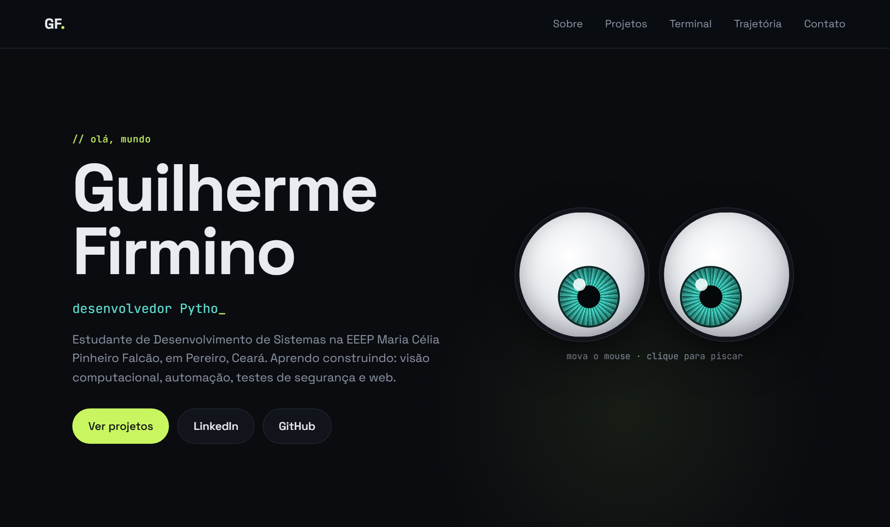
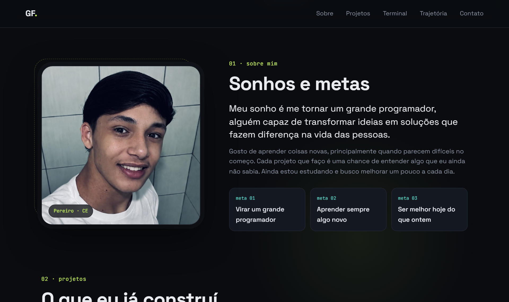
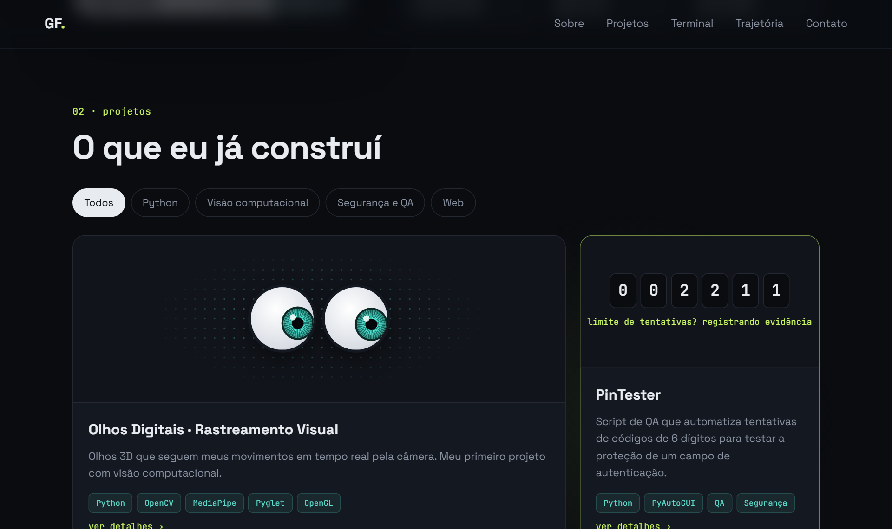
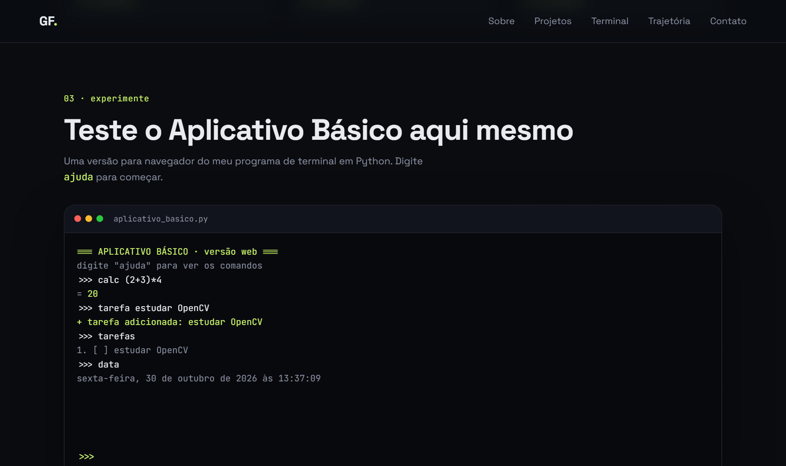

# 👀 Portfólio · Guilherme Firmino

Meu portfólio pessoal, interativo e no ar.

### 🔗 [guilherme-firmino.vercel.app](https://guilherme-firmino.vercel.app)



Sou estudante de Desenvolvimento de Sistemas na EEEP Maria Célia Pinheiro Falcão, em Pereiro (CE). Queria um lugar para reunir os projetos que fui postando no LinkedIn e mostrar um pouco de quem eu sou e aonde quero chegar. Este site é esse lugar.

---

## ✨ O que tem no site

| Seção | O que faz |
| --- | --- |
| **Início** | Dois olhos 3D que seguem o mouse e piscam (uma homenagem ao meu projeto de visão computacional). Clique neles! |
| **Sobre mim** | Minha foto, meus sonhos e minhas metas. |
| **Projetos** | Os 5 projetos do meu GitHub em cards com animações, filtros por área e uma janela de detalhes para cada um. |
| **Terminal** | Uma versão web do meu *Aplicativo Básico* em Python. Dá para usar de verdade: calculadora, data, lista de tarefas e biblioteca. |
| **Trajetória** | Minha formação, a monitoria de 100 horas no laboratório e as ferramentas que uso. |
| **Contato** | Links para o meu LinkedIn e GitHub. |







---

## 🛠️ Com o que eu fiz

- **HTML** para a estrutura das páginas
- **CSS** para o visual: tema escuro, animações, efeito 3D nos cards e layout que se adapta ao celular
- **JavaScript** puro (sem framework) para a interatividade: olhos seguindo o mouse, filtros, janelas de detalhes, contadores animados e o terminal
- **Google Fonts** (Space Grotesk e JetBrains Mono)
- **Git e GitHub** para versionar o código
- **Vercel** para hospedar o site de graça

Não usei nenhuma biblioteca externa de JavaScript. Tudo roda direto no navegador, sem etapa de build.

---

## 🧩 Como eu fiz

1. **Juntei o conteúdo.** Peguei os projetos que já tinha postado no LinkedIn e conferi se cada um tinha o repositório no GitHub.
2. **Pensei no visual.** Escolhi um tema escuro com verde-limão e ciano, cores que lembram terminal e tecnologia.
3. **Criei a estrutura** em `index.html`, com uma seção para cada parte do site.
4. **Fiz o estilo** em `style.css`, usando variáveis de cor no `:root` para mudar o tema fácil, e `@media` para ficar bom no celular.
5. **Adicionei a interatividade** em `script.js`:
   - os olhos calculam o ângulo até o mouse com `Math.atan2` e movem a íris nessa direção;
   - os projetos ficam em uma lista (`projetos`) e os cards são gerados a partir dela, então para adicionar um projeto novo basta incluir um item na lista;
   - o terminal lê o que a pessoa digita, separa o comando e chama a função certa (`calc`, `tarefa`, `livros`...);
   - um `IntersectionObserver` faz as seções aparecerem conforme a página rola.
6. **Testei** no computador e no celular, mexendo em cada parte para ver se tudo funcionava.

---

## 🚀 Como deixei no ar

1. Criei este repositório no GitHub e enviei o código:
   ```bash
   git init
   git add .
   git commit -m "Portfólio interativo"
   git remote add origin https://github.com/Guilherme-Firmino/portfolio.git
   git push -u origin main
   ```
2. Na [Vercel](https://vercel.com), cliquei em **Add New → Project** e importei este repositório.
3. Como o site é só HTML, CSS e JS, escolhi o preset **Other**, sem comando de build, e cliquei em **Deploy**.
4. Em poucos segundos o site ficou no ar em **guilherme-firmino.vercel.app**.

Agora, toda vez que eu faço `git push`, a Vercel publica a versão nova sozinha.

---

## 📁 Estrutura

```
portfolio/
├── index.html    → estrutura do site
├── style.css     → visual e animações
├── script.js     → projetos, olhos, terminal e interações
├── foto.jpg      → minha foto
├── favicon.svg   → ícone da aba
└── docs/         → prints usados neste README
```


---

## 📬 Contato

- LinkedIn: [Guilherme Firmino](https://www.linkedin.com/in/guilherme-firmino-2a240137a/)
- GitHub: [@Guilherme-Firmino](https://github.com/Guilherme-Firmino)

Ainda estou estudando e sigo em crescente evolução. Feedbacks são sempre bem-vindos! ⭐
